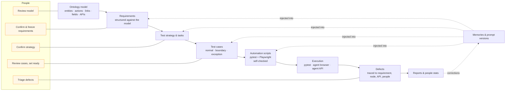
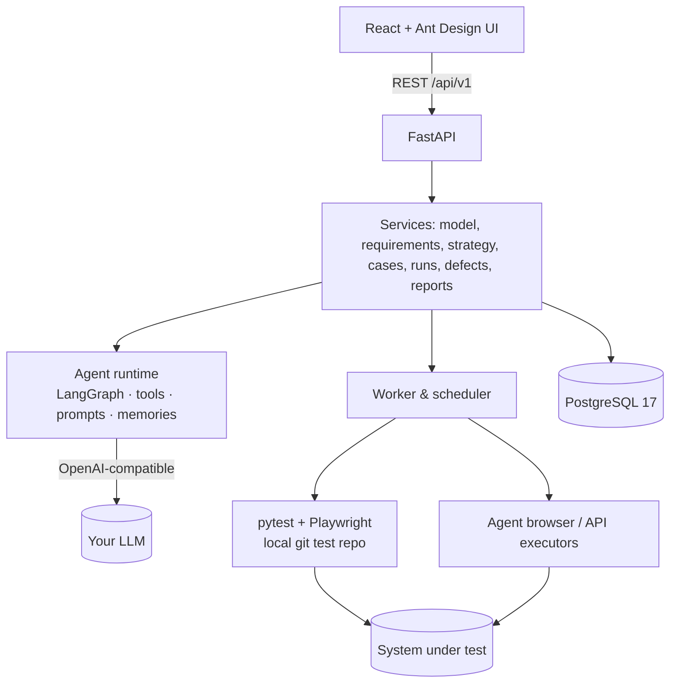

# TestAgent

**An ontology-driven, agent-assisted functional test platform.** Describe your system as a small
ontology model (entities, actions, links, fields), write requirements against it, and let an LLM agent
draft the test strategy, test cases and runnable Playwright/pytest scripts. People stay in charge at
every gate: they confirm, review and set things ready, the agent does the legwork.


[](LICENSE)
[](https://github.com/Coral-TSS/testagent/issues)


> The demo above runs the real UI against the bundled demo app, with a scripted (deterministic) model
> standing in for the LLM so the recording is reproducible. With a real model the flow is the same.

> **Status: initial version (v0.1).** It works end to end and is covered by ~360 backend and ~80 frontend
> tests, but expect rough edges. Feedback, bug reports and ideas are very welcome. Please
> [open an issue](https://github.com/Coral-TSS/testagent/issues).

---

## Why ontology-driven testing?

Most "AI writes your tests" tools prompt a model with a page or a spec and hope for the best. The output
is hard to review, hard to measure and drifts with every prompt. TestAgent puts a **shared model of the
business domain** in the middle:

- **Entities** (PurchaseOrder, Supplier, Payment) with typed **fields** (`amount_minor`, `state`, …)
- **Actions** (Create purchase order, Approve, Record payment) with **preconditions and effects**
  (`PurchaseOrder.state == pending` → `state → approved | rejected`) and the **APIs** that implement them
- **Links** between entities with direction, readings and **cardinality** (Payment *pays* PurchaseOrder, N:1)

Everything hangs off this model:

| Without a model | With the ontology model |
|---|---|
| Requirements are free text | Requirements are **structured** into actor / action / result / constraint items that point at model nodes and fields |
| "Is this enough tests?" is a gut feeling | **Coverage** is measured over requirements, actions, entities and fields; gaps are listed |
| The LLM guesses request bodies and rules | The agent reads preconditions, effects, cardinalities and real API schemas, and generates **boundary / exception** cases from them |
| A failure is "something broke" | A failed execution traces to case → requirement → model node → API → **the people responsible** |
| Lessons are lost | Human **corrections** become memories or prompt patches that are injected the next time |

The model is the contract between people and the agent: people review the model (there is a read-only
*Model review* page with export), the agent works from it, and the platform can check one against the
other.

## Features

- **Ontology modelling**: graph and list views, entity fields, actions with inputs/outputs,
  preconditions and effects, links with cardinality and foreign-key fields, model review with export.
- **API registry**: import from OpenAPI; the import proposes field renames and links that you accept one by one.
- **Versions and requirements**: AI structuring against the model, owners/developers/testers per
  requirement, confirm → freeze (with a model snapshot).
- **Test strategy and tasks**: AI-drafted strategy (scope, test types, depth) and rule-based tasks that
  pick up ready cases automatically.
- **Test cases**: AI generation (normal / boundary / exception per requirement), coverage reports,
  case library, revisions, export.
- **Automation with self-check**: the agent writes a pytest (+ Playwright) script into a local git test
  repo, runs it against the environment and binds it to the case **only if the final self-check passes**.
- **Execution**: pytest scripts, an **agent browser executor** (the agent drives Chromium step by step
  with screenshots and traces), an **agent API executor**, and manual results; scheduled and cron runs.
- **Defects and reports**: defects from failed executions (or let the AI analyse the cause), attribution
  to people by requirement role, task/version reports, severity-weighted people statistics.
- **Learning loop**: corrections on cases, strategies, executions or reports are digested into memories
  and prompt versions; every agent run is traceable (prompts, memories, tool calls).
- **Bring your own model**: any OpenAI-compatible endpoint (OpenAI, DeepSeek, a local server, …). Without
  a model the platform still works for modelling, manual cases, pytest runs, defects and reports.
- **Demo SUT included**: a small procurement-approval app with **3 seeded bugs** to see what the agent finds.

## How it works





- The agent is a LangGraph tool-calling loop with one **entry** per job (structure a requirement,
  generate a strategy, generate cases, automate a case, execute a case in the browser or via API, analyse
  a failure, summarise a report, digest corrections). Each entry gets read tools over the model,
  requirements and APIs, and must finish with a schema-validated `submit_result`; invalid results are
  sent back to the model with the validation errors.
- Generated scripts live in a plain git repository per SUT (`runtime/repos/<sut>`), so you can open,
  edit and run them with normal tools.
- Human-only actions (confirming, freezing, setting ready, accepting suggestions, cause categories)
  are enforced by the backend, not just the UI.

## Quick start (Docker)

Requirements: Docker with Compose v2. The image is ~1.8 GB (it includes Chromium).

```bash
git clone https://github.com/Coral-TSS/testagent.git testagent && cd testagent
cp .env.example .env            # set POSTGRES_PASSWORD (and optionally TESTAGENT_ACCESS_TOKEN)
docker compose up -d --build
docker compose logs testagent | grep "Sign in"
```

Open the printed `http://localhost:8765/#t=…` link (or set `TESTAGENT_ACCESS_TOKEN` in `.env` and open
`http://localhost:8765/#t=<your token>`). Then:

1. **Agent settings** → enter an OpenAI-compatible **Base URL**, **model** and **API key**, click
   *Test connection*. Example for DeepSeek: Base URL `https://api.deepseek.com`, model `deepseek-chat`.
   The key is stored in the `testagent-data` volume (`runtime/secrets.json`), never in the database or logs.
2. Open **SUT → Procurement approval (demo)** and follow the step bar at the top.

The stack has three services: `db` (PostgreSQL 17), `demo` (the demo SUT on http://localhost:8766) and
`testagent` (the platform on http://localhost:8765). Migrations run on start. See
[docs/deployment.md](docs/deployment.md) for configuration, upgrades, backups and troubleshooting.

## Demo walkthrough

The bundled [procurement approval demo](examples/procurement/README.md) has suppliers, purchase orders,
approval by amount and payments, plus 3 deliberately seeded bugs. A typical first hour:

1. **API registry → Import from OpenAPI** (environment `local`): 10 APIs with schemas.
2. **Model**: look at the seeded entities, actions and links; accept the field and link suggestions
   from the import; open **Model review**.
3. **Version → Requirements**: add requirements such as *"Purchase orders of 50,000 or more must be
   approved"*, assign people, click **AI structure**, confirm, then **freeze**.
4. **Test strategy & tasks → AI generate strategy**, then confirm.
5. **Test cases & coverage → AI generate cases**; scripts are generated and self-checked in the background.
   Review the drafts and **set them ready**.
6. Open a task, choose environment `local`, **Run now**; follow the run live.
7. On a failed execution: **AI analyse cause** or **Create defect**; then read the task report and
   **People stats**.
8. Compare with the spoiler section at the end of the demo README: how many of the 3 seeded bugs did the
   agent find?

## Local development

Python 3.12 with [uv](https://docs.astral.sh/uv/), Node.js ≥ 20 and PostgreSQL 17:

```bash
uv sync
cp .env.example .env                      # set TESTAGENT_DATABASE_URL (and TESTAGENT_TEST_DATABASE_URL for tests)
uv run python ops/init_db.py              # creates the databases if missing
PLAYWRIGHT_BROWSERS_PATH=0 uv run playwright install chromium
cd web && npm ci && npm run build && cd ..
uv run python ops/seed_procurement.py     # optional: the demo SUT
uv run testagent                          # opens the browser signed in; starts the demo SUT too
```

On Windows you can double-click `ops\start.cmd`. Checks:

```bash
uv run pytest -q                          # uses TESTAGENT_TEST_DATABASE_URL only
uv run ruff check . && uv run ruff format --check .
cd web && npm run lint && npx tsc -b --noEmit && npm test && npm run build
```

Details: [docs/deployment.md](docs/deployment.md).

## Roadmap

- Chinese (zh-CN) UI and agent output as an option (i18n); the agent output language is already
  configurable with `TESTAGENT_AGENT_LANGUAGE`
- Multi-user mode with accounts and roles (today: single user, local)
- More executors and integrations (CI trigger, issue trackers, test management export)
- Non-functional tests (performance, security) beyond marking them as skipped
- Model import from code / database schemas; richer model-based case generation

Have an idea or a use case? [Open an issue](https://github.com/Coral-TSS/testagent/issues).

## Contributing

Contributions are welcome. See [CONTRIBUTING.md](CONTRIBUTING.md). Please report security issues as
described in [SECURITY.md](SECURITY.md).

## License

[Apache License 2.0](LICENSE). Copyright 2026 Coral-Lee. Third-party components keep their own
licenses, see [docs/third-party-licenses.md](docs/third-party-licenses.md).
