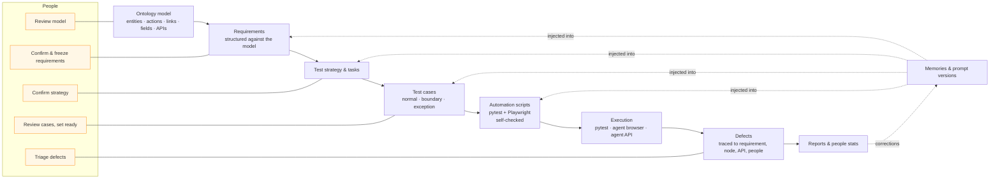
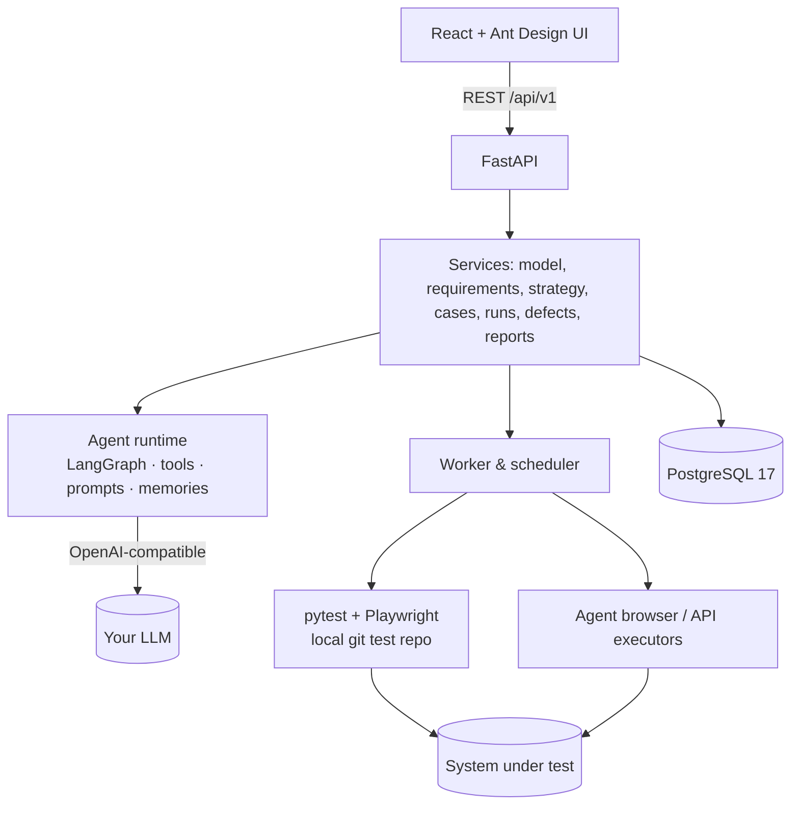

# TestAgent

[English](README.md) | 中文

**本体模型驱动、由 Agent 辅助的功能测试平台。** 把你的系统描述成一个小型本体模型（实体、动作、关系、字段），
对照模型编写需求，再让大模型 Agent 起草测试策略、测试用例和可运行的 Playwright/pytest 脚本。每个关键环节都由人把关：
人负责确认、审阅和设为就绪，Agent 负责干活。


[](LICENSE)
[](https://github.com/Coral-TSS/testagent/issues)


> 上面的演示用真实界面操作自带的演示系统，录制时用一个脚本化（确定性）的模型代替大模型，保证录制可复现。
> 换成真实大模型，流程完全一样。

> **状态：初始版本（v0.1）。** 端到端可用，有约 360 个后端测试和约 80 个前端测试覆盖，但难免有粗糙之处。
> 非常欢迎反馈、报 bug 和提想法，请[提交 issue](https://github.com/Coral-TSS/testagent/issues)。

> 说明：平台界面和 Agent 默认输出目前是英文（Agent 输出语言可以用 `TESTAGENT_AGENT_LANGUAGE` 配置，例如设为 `Chinese`）。
> 下文中的按钮、菜单名保留英文原文，方便对照。

---

## 为什么要用本体模型驱动测试？

大多数「AI 帮你写测试」的工具是把页面或需求文档丢给模型，然后祈祷结果靠谱。生成的东西难审阅、难度量，
每换一次提示词就漂一次。TestAgent 把一份**共享的业务领域模型**放在中间：

- **实体**（PurchaseOrder 采购单、Supplier 供应商、Payment 付款记录），带类型的**字段**（`amount_minor`、`state`……）
- **动作**（创建采购单、审批、记录付款），带**前置条件和影响**
  （`PurchaseOrder.state == pending` → `state → approved | rejected`），以及实现它们的**接口**
- 实体之间的**关系**，有方向、两个方向的读法和**基数**（Payment *支付* PurchaseOrder，N:1）

所有东西都挂在这份模型上：

| 没有模型 | 有本体模型 |
|---|---|
| 需求是自由文本 | 需求被**结构化**为 参与者 / 动作 / 结果 / 约束，每一项指向模型节点和字段 |
| 「测得够不够？」全凭感觉 | **覆盖率**按需求、动作、实体和字段来度量，缺口一目了然 |
| 大模型靠猜请求体和规则 | Agent 读取前置条件、影响、基数和真实接口 schema，并据此生成**边界 / 异常**用例 |
| 失败只知道「哪里坏了」 | 失败的执行可以追溯：用例 → 需求 → 模型节点 → 接口 → **负责的人** |
| 经验教训随手就丢了 | 人写的**纠错**会变成记忆或新版本提示词，下次自动注入 |

模型是人和 Agent 之间的契约：人审阅模型（有只读的 *Model review* 模型审阅页，可导出），Agent 基于模型干活，
平台可以拿两者互相校验。

## 功能

- **本体建模**：图视图和列表视图，实体字段，带输入/输出、前置条件和影响的动作，带基数和外键字段的关系，
  可导出的模型审阅。
- **接口注册表**：从 OpenAPI 导入；导入后会给出字段改名和关系建议，由你逐条采纳。
- **版本与需求**：对照模型的 AI 结构化，每条需求指定负责人/开发/测试，确认 → 冻结（同时生成模型快照）。
- **测试策略与任务**：AI 起草策略（范围、测试类型、强度），基于规则的任务会自动纳入就绪的用例。
- **测试用例**：AI 生成（每条需求覆盖正常 / 边界 / 异常），覆盖率报告，用例库，修订历史，导出。
- **带自检的自动化**：Agent 把 pytest（+ Playwright）脚本写进本地 git 测试仓，在环境上运行，
  **只有最后一次自检通过**才绑定到用例。
- **执行**：pytest 脚本、**Agent 浏览器执行器**（Agent 一步步驱动 Chromium，带截图和 trace）、
  **Agent 接口执行器**，以及人工结果；支持定时和 cron 执行。
- **缺陷与报告**：从失败的执行创建缺陷（或让 AI 分析原因），按需求角色归因到人，任务/版本报告，
  按严重度加权的人员统计。
- **学习闭环**：对用例、策略、执行或报告的纠错会被整理成记忆和提示词版本；每次 Agent 运行都可追溯
  （提示词、记忆、工具调用）。
- **自带模型**：任何 OpenAI 兼容接口（OpenAI、DeepSeek、本地服务……）。不配置模型时，建模、手写用例、
  pytest 执行、缺陷和报告照常可用。
- **自带演示系统**：一个小型采购审批应用，**预埋了 3 个缺陷**，看看 Agent 能找到几个。

## 工作原理





- Agent 是一个 LangGraph 工具调用循环，每类工作一个**入口**（结构化需求、生成策略、生成用例、自动化用例、
  在浏览器或通过接口执行用例、分析失败、总结报告、整理纠错）。每个入口都有读取模型、需求和接口的工具，
  最后必须调用经过 schema 校验的 `submit_result` 结束；结果不合法时，会带着校验错误退回给模型重做。
- 生成的脚本放在每个被测系统各自的普通 git 仓库里（`runtime/repos/<sut>`），可以用常规工具打开、修改和运行。
- 只能由人完成的操作（确认、冻结、设为就绪、采纳建议、缺陷原因分类）由后端强制保证，而不仅仅是界面上的限制。

## 快速开始（Docker）

需要：Docker 和 Compose v2。镜像约 1.8 GB（内含 Chromium）。

```bash
git clone https://github.com/Coral-TSS/testagent.git testagent && cd testagent
cp .env.example .env            # set POSTGRES_PASSWORD (and optionally TESTAGENT_ACCESS_TOKEN)
docker compose up -d --build
docker compose logs testagent | grep "Sign in"
```

打开日志里打印的 `http://localhost:8765/#t=…` 链接（或者在 `.env` 里设置 `TESTAGENT_ACCESS_TOKEN`，然后打开
`http://localhost:8765/#t=<你的令牌>`）。接着：

1. **Agent settings**（Agent 配置）→ 填写 OpenAI 兼容的 **Base URL**、**模型名**和 **API key**，点
   *Test connection*。以 DeepSeek 为例：Base URL `https://api.deepseek.com`，模型 `deepseek-chat`。
   Key 保存在 `testagent-data` 数据卷里（`runtime/secrets.json`），不会进数据库，也不会写进日志。
2. 打开 **SUT → Procurement approval (demo)**（采购审批演示系统），按页面顶部的步骤条往下走。

整个栈有三个服务：`db`（PostgreSQL 17）、`demo`（演示被测系统，http://localhost:8766）和
`testagent`（平台，http://localhost:8765）。启动时自动执行数据库迁移。配置、升级、备份和排错见
[docs/deployment.md](docs/deployment.md)（英文）。

## 演示流程

自带的[采购审批演示系统](examples/procurement/README.md)（英文）包含供应商、采购单、按金额审批和付款，
还故意埋了 3 个缺陷。第一个小时通常这样走：

1. **API registry → Import from OpenAPI**（选择环境 `local`）：导入 10 个带 schema 的接口。
2. **Model**：看看预置的实体、动作和关系；采纳导入产生的字段和关系建议；打开 **Model review**。
3. **Version → Requirements**：添加需求，比如 *"Purchase orders of 50,000 or more must be approved"*
   （5 万及以上的采购单必须审批），指定相关人员，点 **AI structure**，确认后**冻结**（freeze）。
4. **Test strategy & tasks → AI generate strategy**，然后确认。
5. **Test cases & coverage → AI generate cases**；脚本会在后台生成并自检。审阅草稿后把它们**设为就绪**（set ready）。
6. 打开一个任务，选择环境 `local`，点 **Run now**，实时查看执行进度。
7. 在失败的执行上：点 **AI analyse cause** 或 **Create defect**；然后看任务报告和 **People stats**（人员统计）。
8. 对照演示系统 README 末尾的剧透部分：3 个预埋缺陷，Agent 找到了几个？

## 本地开发

Python 3.12 + [uv](https://docs.astral.sh/uv/)、Node.js ≥ 20 和 PostgreSQL 17：

```bash
uv sync
cp .env.example .env                      # set TESTAGENT_DATABASE_URL (and TESTAGENT_TEST_DATABASE_URL for tests)
uv run python ops/init_db.py              # creates the databases if missing
PLAYWRIGHT_BROWSERS_PATH=0 uv run playwright install chromium
cd web && npm ci && npm run build && cd ..
uv run python ops/seed_procurement.py     # optional: the demo SUT
uv run testagent                          # opens the browser signed in; starts the demo SUT too
```

Windows 上可以直接双击 `ops\start.cmd`。检查命令：

```bash
uv run pytest -q                          # uses TESTAGENT_TEST_DATABASE_URL only
uv run ruff check . && uv run ruff format --check .
cd web && npm run lint && npx tsc -b --noEmit && npm test && npm run build
```

详见 [docs/deployment.md](docs/deployment.md)（英文）。

## 路线图

- 中文（zh-CN）界面和 Agent 输出可选（国际化）；Agent 输出语言现在已经可以用 `TESTAGENT_AGENT_LANGUAGE` 配置
- 多用户模式，支持账号和角色（目前是单用户、本机使用）
- 更多执行器和集成（CI 触发、缺陷跟踪系统、测试管理工具导出）
- 非功能测试（性能、安全），而不只是标记为跳过
- 从代码 / 数据库表结构导入模型；更丰富的基于模型的用例生成

有想法或使用场景？欢迎[提交 issue](https://github.com/Coral-TSS/testagent/issues)。

## 参与贡献

欢迎贡献，请看 [CONTRIBUTING.md](CONTRIBUTING.md)（英文）。安全问题请按 [SECURITY.md](SECURITY.md) 中的方式私下报告。

## 许可证

[Apache License 2.0](LICENSE)。Copyright 2026 Coral-Lee。第三方组件保留各自的许可证，见
[docs/third-party-licenses.md](docs/third-party-licenses.md)。
